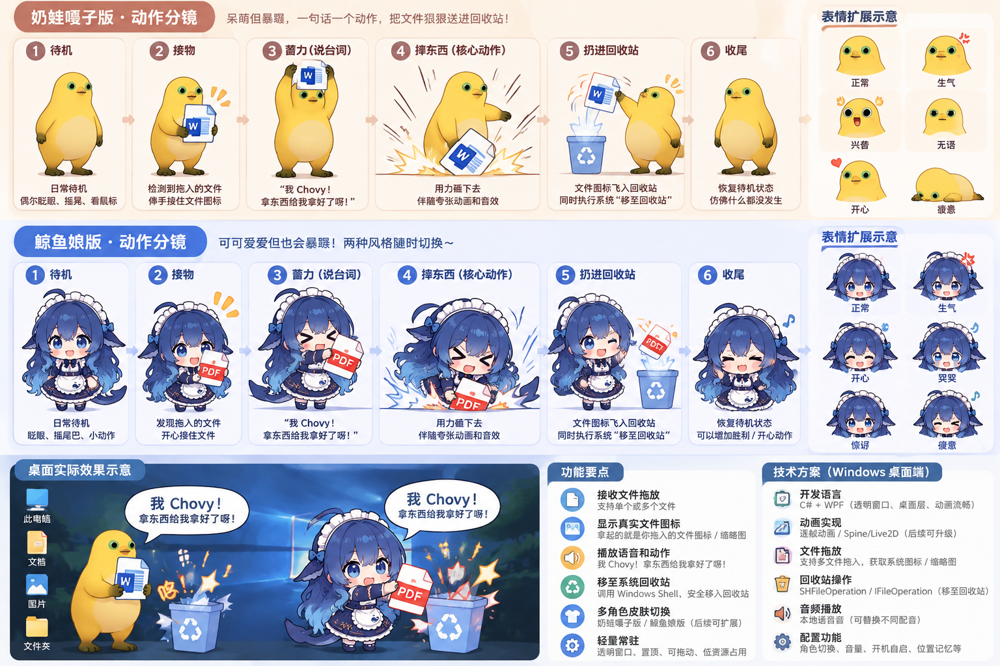

# 大肥鱼回收站桌宠 🐳

把文件拖给鲸鱼娘：第一次砸下去，第二次一口吞掉。两种动作轮流播放，最后把文件送进 **Windows 系统回收站**。

默认鲸鱼娘，奶蛙可在右键菜单切换。v0.5 的默认宽高为原版的一半，适合放在桌面角落。

## 下载与启动

**[下载 Windows v0.5 启动包](https://github.com/zhangyx123-dish/Dafeiyu-Recycle-Bin/raw/refs/heads/main/downloads/RecyclePet-Windows-v0.5.cmd)** · [查看文件校验值](downloads/SHA256SUMS.txt)

1. 下载 `RecyclePet-Windows-v0.5.cmd`，双击运行。更新时先右键退出旧桌宠。
2. 等待它完成回收与恢复自检，显示“真实回收”后再拖入文件。
3. 将本地普通文件拖到角色上，动画结束后可在系统回收站中查看、还原。

需要 Windows 10/11、自带的 Windows PowerShell 5.1 与 .NET Framework WPF。无需安装开发 SDK、配置 AI API 或使用管理员权限。请以普通用户启动，方便接收资源管理器拖放。

启动包会展开到 `%LOCALAPPDATA%\RecyclePetApp` 后运行。它不会注册开机启动、服务或文件关联。

## 动作与操作

| 操作 | 体验 |
| --- | --- |
| 第一次有效拖放 | 砸文件，播放 chovy，字幕“我 Chovy！东西给我拿好了呀！” |
| 第二次有效拖放 | 吞文件，播放 token，字幕“我要吃你的token了” |
| 后续拖放 | 砸 → 吞 → 砸，循环；重启从砸文件开始 |
| 一次拖入多个文件 | 算一轮动作，逐个处理文件，最多 20 个 |
| 双击角色 | 演示动作，不处理文件，不占真实拖放轮次 |
| 拖动角色 | 调整桌面位置 |
| 右键角色 | 换角色、静音、试听、打开回收站、查看记录或退出 |
| 按 Esc | 在回收提交前取消本次动作，文件不处理，也不占轮次 |

奶蛙备选保持砸文件动作，不占用鲸鱼娘的轮次。忙碌时的重复拖放、未通过校验的文件都不计轮次。右键试听也不计轮次。

## 动作设计总览

## 吞咽动作图集

真实文件图标由程序动态显示，跟随手部移动，并在嘴边逐渐被遮挡、缩小。

## 文件处理范围

拖入文件代表你希望把它移到系统回收站。动画完成后才提交回收；收到系统完成回执后才显示结果。程序不提供永久删除或清空回收站功能。

当前接受本地固定 NTFS 磁盘上的普通文件；暂不接收文件夹、网络盘、移动盘、链接、云占位文件、系统文件或程序自身素材。回收失败会给出具体原因。文件路径和运行记录保存在本机，不发送到服务器。

启动时用程序自己新建的小文件完成回收、还原与内容比对。自检失败时只开放演示。回收后的文件可以通过 Windows 回收站正常还原。

## 从源码启动

下载仓库并解压，保留 `scripts`、`assets`、`manifest.json` 和两个启动文件的相对位置，运行根目录的 `Start-RecyclePet.cmd`。

- 默认角色：`Start-RecyclePet.cmd`
- 奶蛙备选：`Start-RecyclePet.cmd -Skin frog`
- 原生编译与素材检查：`Test-RecyclePet.cmd`
- 自建测试文件的回收与恢复探测：`Test-RecyclePet.cmd -RecycleProbe`
- Linux 上只检查包完整性：`python scripts/check_bundle.py --bundle-only`
- 重新生成独立启动包：`python tools/build_launcher.py`

源码使用 Windows 自带编译器在启动进程内编译 C#，无需 .NET SDK。运行记录位于 `%LOCALAPPDATA%\RecyclePet`。

## 版本与反馈

当前版本：v0.5.0。作者已在自己的 Windows 桌面使用并反馈体验良好；不同机器仍会在每次启动时执行自检。

遇到问题请提交 [Issue](https://github.com/zhangyx123-dish/Dafeiyu-Recycle-Bin/issues)，说明 Windows 版本、启动包版本和错误文字。分享日志前请先遮去个人文件路径。

详细变更见 [v0.5.0 版本说明](docs/release-v0.5.0.md)。

## 素材与授权

本仓库尚未指定统一开源许可证。代码、角色图片和配音的来源与授权范围需分别说明，不将图片或配音默认视为 MIT 授权。详见 [素材说明](docs/ASSETS.md)。
